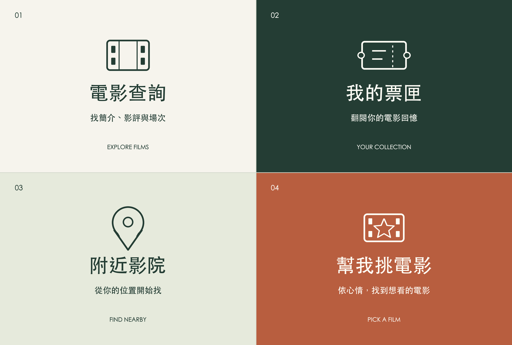

# 電影夥伴 Bot 05：四格 Rich Menu × Google ADK

讓使用者打開 Zona Movie 聊天室，就能找到查電影、私人票匣、附近影院與偏好推薦。

| 電影查詢 | 我的票匣 |
| --- | --- |
| 附近影院 | 幫我挑電影 |



## 和 Google ADK 的關係

沿用 Bot 04 的 `MovieCompanion`、`LlmAgent`、`InMemoryRunner` 與電影／場次／地圖工具，新增 **`open_movie_feature` FunctionTool**，選單提供 `movies`、`shelf`、`nearby`、`recommend`；另保留 `new_ticket` 供聊天開啟新增表單。

- 電影查詢：Rich Menu postback 經已驗簽 webhook 交給 ADK，呼叫功能入口工具；接續輸入片名後使用原有電影工具。
- 附近影院：同樣經 ADK 提供位置分享 quick reply 或地標引導；實際位置事件仍交給 ADK 的 `nearby_cinemas` 工具與 Google Maps。
- 我的票匣：Rich Menu 直接開啟正式 MINI App；ADK 在對話中也能透過 `open_movie_feature(shelf)` 提供相同入口。
- 幫我挑電影：postback 經 ADK `open_movie_feature(recommend)` 詢問心情／類型，之後由 `recommend_movies` 查 TMDB 並篩選最多三部，附類型配對原因與來源。
- 記錄心得：在我的票匣裡新增，聊天也保留 `open_movie_feature(new_ticket)` 的 `?action=new` 入口。

URI 按鈕由 LINE 直接開啟網頁，點擊本身不會觸發模型。私人票匣 CRUD 保留一般 API 與 LINE 後端驗證；網址由程式產生，模型不能指定其他人的 actor、偽造登入或自動儲存心得。完整資料的聊天記錄仍使用 `prepare_ticket` 草稿及使用者確認。

## 入口與檔案

- [Zona Movie LINE](https://line.me/R/ti/p/@796qcwyz)
- [Published 票匣](https://miniapp.line.me/2012222034-AVyO2nk3)
- [直接新增心得](https://miniapp.line.me/2012222034-AVyO2nk3?action=new)
- [無金鑰示範票匣](https://movie-bot-03.136-67-154-252.sslip.io/tickets/?preview=1)
- [Rich Menu 圖片](assets/richmenu.png)、[四區座標與動作](assets/richmenu.json)
- [ADK 與選單設計](docs/richmenu.md)

## 本機啟動與驗證

需要 Node.js 24.13+、npm 11.8+。

```bash
npm ci --ignore-scripts
npm test
npm run preview
```

示範新增表單：`http://127.0.0.1:3104/tickets/?preview=1&action=new`。它只有虛構的頁面記憶體資料，不會新增正式票根。

```bash
npx playwright install chromium
npm run test:browser
```

測試包含真正的 ADK Runner → FunctionTool → FunctionResponse（使用替代模型）、已驗簽 Rich Menu postback、LINE 定位 quick reply、圖片與區域、部署失敗及回復，還有原本的資料隔離、登入與票匣 CRUD。

真實 Gemini／ADK 的四功能工具測試：

```bash
npm run smoke:richmenu:adk
```

此命令需既有 Gemini 與 LIFF 設定，會消耗少量模型用量；使用測試 actor、記憶體 SQLite，不發送 LINE 訊息或寫入正式票根。

## 安裝 Rich Menu

使用現有 Messaging API 的 `LINE_CHANNEL_ACCESS_TOKEN`，以及正式的 `LIFF_ID`、`LIFF_APP_TYPE=miniapp`。不要使用 MINI App 的登入憑證代替 Bot channel access token。

先準備及部署 Bot 05，確認新增表單與 postback 已支援，再啟用選單：

```bash
npm run richmenu:plan -- --liff-url https://miniapp.line.me/2012222034-AVyO2nk3
npm run richmenu:inspect
npm run richmenu:apply
```

安裝程式先讓 LINE 驗證物件，再建立或復用相同版本的選單、上傳及校驗圖片，最後設定預設。會將原預設選單寫到忽略追蹤的 `data/richmenu-install.json`；重跑不會建立重複選單，也不會刪除舊選單。若圖片上傳失敗，保留原預設。

需要回復時：

```bash
npm run richmenu:rollback
```

若目前預設已由其他操作更改，程式會停止回復，避免覆蓋該設定。已單獨綁定其他選單的使用者可能仍看到個別選單；本版不解除那些綁定。

圖稿由程式繪製，2500×1686 PNG、小於 1 MB。重新產生：

```bash
python3 -m pip install -r scripts/requirements-artwork.txt
python3 scripts/render-richmenu.py --font /path/to/traditional-chinese-font.ttc
```

[部署](docs/deployment.md) · [LINE / MINI App 設定](docs/liff-setup.md) · [隱私](docs/privacy.md) · [資料來源](docs/credits.md)

推薦流程、資料限制與驗證方式見 [推薦功能說明](docs/recommendations.md)。
